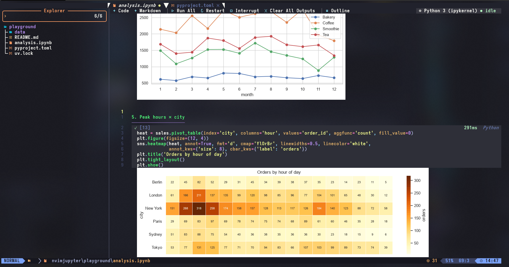

<div align="center">

# cellbook.nvim

**Jupyter notebooks in Neovim.** Open the `.ipynb`, run it, see the plots.<br>
No browser. No conversion. No remote plugin host.

[](https://neovim.io)
[](https://luajit.org)
[](https://docs.astral.sh/uv/)
[](LICENSE)



<sub>A real notebook in Neovim: clickable toolbar, executed cells with timing, a matplotlib line chart and a seaborn heatmap drawn inline (Windows Terminal, Sixel).</sub>

</div>

---

## Contents

- [Features](#features)
- [Requirements](#requirements)
- [Installation](#installation)
- [Quick start](#quick-start)
- [Kernels and Python environments](#kernels-and-python-environments)
- [Images and plots](#images-and-plots)
- [Keymaps](#keymaps)
- [Commands](#commands)
- [Configuration](#configuration)
- [Lua API and events](#lua-api-and-events)
- [How it works](#how-it-works)
- [FAQ](#faq)
- [Development](#development)
- [Roadmap](#roadmap)
- [License](#license)

## Features

- **Edit `.ipynb` directly.** `:e analysis.ipynb` gives you an editable buffer and `:w` writes nbformat 4.x JSON back to the same file. A notebook opened and saved without edits is **byte-identical**; edits only change the cells you touched, so git diffs stay small.
- **Looks like a notebook.** Code cells are cards with a `▶ [3] … 0.4s  Python` header, outputs sit under each cell, and markdown cells are rendered (headings, bold, inline code, links, lists) — raw markdown appears only while you type in it.
- **Toolbar.** A clickable window bar with **+ Code · + Markdown · Run All · Restart · Interrupt · Clear All Outputs · Outline** and the current kernel with its state.
- **Real Jupyter kernels.** A small Python bridge (`jupyter_client`, stdio, newline-delimited JSON) runs any installed kernel. Run cell, run and advance, run all / above / below, run a selection, interrupt, restart, restart-and-run-all — Neovim never blocks.
- **Select Kernel like VS Code.** Pick a Python environment (project `.venv`, conda, uv-installed or system Pythons) or any Jupyter kernelspec. With [uv](https://docs.astral.sh/uv/) the Jupyter packages are layered on top of the environment, so it needs nothing installed. The choice is remembered per notebook.
- **Rich outputs.**
  - Plots as real images (Sixel, kitty graphics via snacks.nvim/image.nvim) or, in any terminal, as true-colour block characters.
  - pandas DataFrames as box-drawn tables; wide frames are split into column blocks that fit the window.
  - Streams, results and tracebacks with ANSI colours; long output is truncated with a full-view split.
- **Vim-native cell editing.** `]c` / `[c`, `ic` / `ac` text objects, add / delete / move / split / merge / change type — all undoable. `dac` then `u` brings the cell back **with its outputs**.
- **Real buffer text.** Code cells keep the kernel language's filetype, so LSP, Treesitter, completion, formatters and your own keymaps work unchanged. Diagnostics on IPython magics (`%time`, `!pip`) are hidden.
- **Zero configuration.** No `setup()` needed. `:checkhealth cellbook` tells you exactly what is missing and how to fix it.

## Requirements

| | Needed for | Notes |
|---|---|---|
| **Neovim ≥ 0.11** | everything | |
| [**uv**](https://docs.astral.sh/uv/) *or* Python ≥ 3.9 with `jupyter_client` + `ipykernel` | running cells | Opening, editing and saving notebooks works without Python |
| A terminal with **Sixel** (Windows Terminal ≥ 1.22, WezTerm, foot, mlterm) + **ImageMagick** | sharp inline plots | optional |
| [snacks.nvim](https://github.com/folke/snacks.nvim) (image) or [image.nvim](https://github.com/3rd/image.nvim) in kitty / Ghostty / WezTerm | sharp inline plots via the kitty graphics protocol | optional |
| `'termguicolors'` | block-character plots (fallback for any terminal) | |

Tested on Windows 11 with Windows Terminal 1.24, Neovim 0.11.5, uv 0.8 and Python 3.13.

## Installation

**[lazy.nvim](https://github.com/folke/lazy.nvim)** (also LazyVim — put it in `lua/plugins/cellbook.lua`):

```lua
{
  "j4flmao/cellbook.nvim",
  lazy = false, -- only registers *.ipynb autocommands; startup cost < 1 ms
  opts = {},
}
```

**Neovim 0.12+ built-in package manager:**

```lua
vim.pack.add({ "https://github.com/j4flmao/cellbook.nvim" })
```

Then run:

```vim
:checkhealth cellbook
```

## Quick start

```sh
nvim analysis.ipynb
```

1. Put the cursor in a code cell and press `<S-CR>` (or `\r`) — the first run starts the kernel (with uv the first start may take a few seconds while packages are installed into uv's cache).
2. Press `\R` (or click **▷ Run All**) to run the whole notebook.
3. Click **◉ Python 3 …** in the toolbar (or `\K`) to switch to another environment.
4. `:w` saves the notebook, outputs included.

Try it with the bundled example:

```sh
git clone https://github.com/j4flmao/cellbook.nvim
nvim -u cellbook.nvim/tests/minimal_init.lua cellbook.nvim/examples/demo.ipynb
```

## Kernels and Python environments

Without a choice, the bridge (and with it the default `python3` kernel) is started with the first that works:

1. `python` from `setup()` — a path, or a full command such as `{ "uv", "run", "python" }`
2. `$VIRTUAL_ENV`, then `$CONDA_PREFIX`
3. `uv run --with jupyter_client --with ipykernel --with pillow python` in the notebook's folder — a uv project there (its `.venv` and dependencies such as pandas) is used, with the Jupyter packages layered on top
4. the nearest `.venv` above the notebook
5. `python3`, then `python`

A candidate without `jupyter_client` is skipped automatically. **Select Kernel** (`\K`, `:Cellbook kernel` or the toolbar) lists:

- **Python environments** — `.venv` / `venv` / `env` next to or above the notebook, `$VIRTUAL_ENV`, conda environments, Pythons installed by uv, and `python3` / `python` on `$PATH`
- **Jupyter kernels** — every installed kernelspec (R, Julia, …)

The choice is saved for the notebook and written to its `kernelspec` metadata. `:Cellbook info` shows which interpreter and kernel are in use.

## Images and plots

`image.backend = "auto"` picks the first available renderer:

| Renderer | Terminals | Quality |
|---|---|---|
| **snacks.nvim** image | kitty, Ghostty, WezTerm (kitty graphics protocol) | real image |
| **image.nvim** | kitty, WezTerm… (not on Windows) | real image |
| **Sixel** (built in) | Windows Terminal ≥ 1.22, WezTerm, foot, mlterm — needs ImageMagick | real image |
| **Blocks** (fallback) | any terminal with `'termguicolors'` | shapes and colours, small text is not readable |

Notes on the Sixel renderer:

- Images are encoded once with ImageMagick and cached; only the bands that are on screen are drawn, so plots partly scrolled out of view still show.
- While you scroll, the terminal moves the pixels with the text; visible parts are repainted once scrolling settles.
- On Windows the data is written straight to the terminal's console and the cell size is measured from the Windows Terminal window. If a picture looks stretched or has gaps, set `image = { cell_size = { 10, 20 } }` (pixels per cell).
- If your terminal is not detected automatically, force it with `image = { backend = "sixel" }`.

`<localleader>o` on a cell always opens the full-resolution image in your system viewer.

## Keymaps

Buffer-local, in notebook buffers only. `<localleader>` is `\` by default.

| Key | Action |
|---|---|
| `]c` / `[c` | next / previous cell (diff mode keeps its own `]c`) |
| `ic` / `ac` | inner cell / around cell (operator-pending and visual) |
| `<S-CR>` | run cell and go to the next one |
| `<C-CR>` | run cell (visual mode: run the selection) |
| `<localleader>r` / `R` | run cell / run all |
| `<localleader>a` / `b` | add code cell above / below |
| `<localleader>m` | toggle code ↔ markdown |
| `<localleader>d` | delete cell |
| `<localleader>k` / `j` | move cell up / down |
| `<localleader>s` / `J` | split at cursor / merge with the next cell |
| `<localleader>c` / `C` | clear output / clear all outputs |
| `<localleader>o` | open full output (split) or image (system viewer) |
| `<localleader>i` / `0` | interrupt / restart the kernel |
| `<localleader>K` | select kernel |

Remap or disable any of them:

```lua
require("cellbook").setup({
  keymaps = { run_cell = "<leader>jr", run_all = false }, -- or keymaps = false
})
```

`<S-CR>` / `<C-CR>` need a terminal that reports them (kitty, WezTerm, Ghostty, Alacritty, Windows Terminal).

## Commands

`:Cellbook` alone opens a picker with every subcommand.

| Command | Action |
|---|---|
| `:Cellbook run` | run the current cell (with a range: run those lines) |
| `:Cellbook run_next` · `run_all` · `run_above` · `run_below` | run variants |
| `:Cellbook interrupt` · `restart [run_all]` · `shutdown` | kernel control |
| `:Cellbook kernel` | select kernel |
| `:Cellbook add [above\|below] [code\|markdown\|raw]` | add a cell |
| `:Cellbook delete` · `move up\|down` · `split` · `merge [below\|above]` | edit cells |
| `:Cellbook type code\|markdown\|raw` | change the cell type |
| `:Cellbook clear [all]` · `toggle [all]` · `open` | outputs |
| `:Cellbook info` · `log` · `raw` | notebook/kernel info, bridge log, the JSON that `:w` writes |
| `:Cellbook refresh` · `sync` | redraw everything; turn typed `# %%` lines into cells |

## Configuration

Everything is optional. Defaults:

```lua
require("cellbook").setup({
  python = nil, -- nil = auto (see "Kernels and Python environments")
  uv = { enabled = "auto", with = { "jupyter_client>=8", "ipykernel>=6", "pillow" }, args = {} },
  default_language = "python",
  kernel = {
    default = nil, -- kernel for notebooks without one (nil = ask)
    autostart = false,
    shutdown_on_close = true,
    cwd = "notebook", -- "notebook" | "cwd"
    start_timeout = 180,
  },
  run_all = { stop_on_error = true },
  output = {
    max_lines = 30,
    show_stderr = true,
    ansi = true,
    html_tables = true, -- DataFrames as box tables
    mime_priority = { "image/png", "image/jpeg", "image/svg+xml", "text/markdown", "text/plain" },
  },
  image = {
    backend = "auto", -- "auto" | "snacks" | "image.nvim" | "sixel" | "none"
    cell_size = nil, -- sixel: { w, h } pixels per cell (nil = measure)
    max_height = 30, -- rows
    blocks = "sextant", -- fallback renderer: "sextant" | "half" | false
    only_visible = true,
  },
  ui = {
    toolbar = true,
    render_markdown = true,
    cell_header = true,
    cell_padding = 2,
    output_gutter = "▎",
    show_execution_time = true,
  },
  lsp = { filter_magic_diagnostics = true },
  keymaps = true,
  save = { strip_outputs = false }, -- true: never write outputs (clean git diffs)
})
```

Unknown keys are reported with a suggestion ("did you mean `output.max_lines`?"). Per-buffer overrides go in `vim.b.cellbook_config`. Every option, command, highlight group and API function is documented in `:help cellbook`.

## Lua API and events

```lua
local cb = require("cellbook")
cb.run_cell()                  -- also run_cell_and_next, run_all, run_above, run_below, run_range
cb.add_cell(0, { where = "below", type = "markdown" })
cb.select_kernel()
cb.current_cell()              -- { index, id, type, run_state, execution_count }
cb.statusline()                -- " python3 ● idle  [3/12]"
```

Statusline (lualine):

```lua
{ function() return require("cellbook").statusline() end,
  cond = function() return require("cellbook").is_notebook() end }
```

`User` events: `CellbookAttached`, `CellbookKernelStarted`, `CellbookKernelStateChanged`, `CellbookCellExecuted`, `CellbookSaved`.

```lua
vim.api.nvim_create_autocmd("User", {
  pattern = "CellbookCellExecuted",
  callback = function(ev)
    if ev.data.duration_ms > 10000 then
      vim.notify(("Cell %d finished in %.1fs"):format(ev.data.index, ev.data.duration_ms / 1000))
    end
  end,
})
```

Custom image renderers can be added with `require("cellbook").register_renderer({...})` — see `:help cellbook-renderers`.

## How it works

```text
:e nb.ipynb ─► JSON parser (keeps every field) ─► percent-format buffer (# %% cells)
                                                   │  extmarks track cells, decorate headers,
                                                   │  render markdown and outputs (virtual lines)
run cell ────► stdio bridge (python/cellbook_bridge.py, jupyter_client) ─► Jupyter kernel
                ◄── iopub output, streamed and rendered as it arrives
:w ──────────► unchanged cells reuse their original JSON ─► Jupyter-formatted JSON (indent=1, sorted keys)
```

- The buffer is valid source code for the kernel language; markdown cells are comment-prefixed (`# `) with the prefix concealed.
- Cell boundaries live in extmarks, so a literal `# %%` inside a cell never splits it, and undo restores cells together with their outputs.
- Outputs are virtual lines and images, never buffer text — LSP and undo never see them.

## FAQ

<details>
<summary><b>How is this different from molten-nvim, jupytext or jupynium?</b></summary>

molten-nvim runs code from any buffer but needs Neovim's Python remote-plugin host (`pynvim`, `:UpdateRemotePlugins`) and edits notebooks through jupytext/quarto. jupytext-based setups convert notebooks to text files. jupynium and neopyter drive a browser running JupyterLab. cellbook.nvim edits the `.ipynb` itself, keeps it byte-identical when unchanged, talks to the kernel through a standalone stdio bridge and needs no browser.
</details>

<details>
<summary><b>Why do markdown cells start with <code>#</code> in the buffer?</b></summary>

So the buffer stays valid source code and Treesitter/LSP never see prose as code. The prefix is concealed and added/removed automatically; lines you type without it are kept as they are.
</details>

<details>
<summary><b>I typed <code># %%</code> and no new cell appeared.</b></summary>

By design: a literal `# %%` inside a cell (for example in a string) must never split it. Use `\b` / `:Cellbook add`, or run `:Cellbook sync` to turn typed delimiter lines into cells.
</details>

<details>
<summary><b>Plots look blocky.</b></summary>

No graphics renderer is active, so the block-character fallback is used. Use a Sixel terminal with ImageMagick installed, or snacks.nvim image in kitty/Ghostty/WezTerm, and check `:Cellbook info` (line `Images:`). `\o` always opens the original image.
</details>

<details>
<summary><b>Interrupt does not stop <code>time.sleep()</code> on Windows.</b></summary>

A CPython limitation on Windows: the simulated Ctrl-C is only seen between bytecodes. Code that is computing is interrupted immediately.
</details>

## Development

```sh
uv sync                                  # dev environment: pytest, ruff, nbformat, ipykernel, pillow
uv run scripts/make_fixtures.py --bench  # (re)generate fixtures and the benchmark notebook
./scripts/test.sh                        # Lua unit + integration tests (mini.test, bootstrapped into .tests/)
./scripts/test.sh e2e                    # real kernel execution
./scripts/test.sh bench                  # performance budgets
uv run pytest                            # bridge protocol tests
stylua --check lua plugin tests && uv run ruff check
```

On Windows run `scripts/test.sh` from Git Bash. See [CONTRIBUTING.md](CONTRIBUTING.md) and the design documents in [`specs/001-notebook-core`](specs/001-notebook-core/spec.md).

## Roadmap

Kernel-backed completion and hover, a variable explorer, remote Jupyter servers, cell-level git diffs and Quarto support are planned — see [ROADMAP.md](ROADMAP.md).

## License

[MIT](LICENSE)
